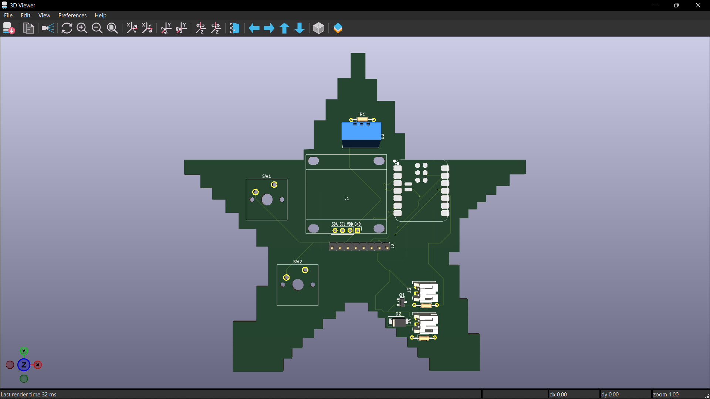
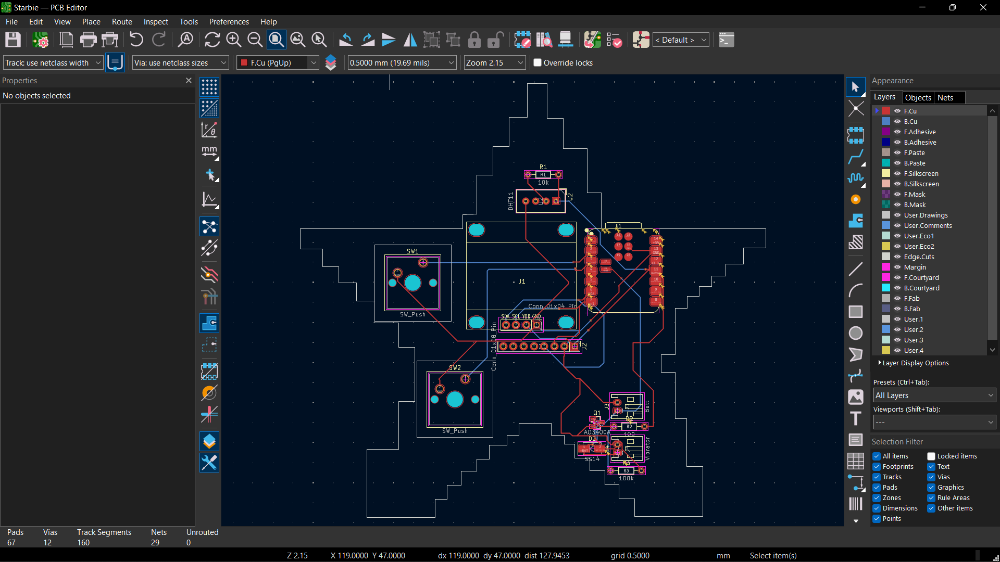

# Starbie

Starbie is a tiny motion-controlled digital pet — essentially a desktop Tamagotchi with minimal gameplay buttons. Instead of relying entirely on button presses, you interact with the pet by moving the device.

Built around the Seeed XIAO ESP32-C3, Starbie uses an OLED display to bring the pet to life and motion input to respond to interactions. My version adds a vibration motor for physical feedback and a custom PCB designed to integrate the electronics used.

The PCB design and firmware are complete, but the PCB has not yet been tested.

## What It Is

Starbie is designed to sit on your desk, display its personality on a small screen, and react to how you handle it. Its interface combines a tilt-controlled radial menu, pet animations, and a stats screen.

The custom PCB integrates the microcontroller, display connections, buttons, sensors, and additional circuitry for vibration feedback. The design incorporates both through-hole and surface-mount components.

## Why?

This project was created as my Week 1 project for [Half Life](https://halflife.hackclub.com/?ref=2639), a 10 weeks hardware-building program powered by hackclub.

My goal was to adapt the original design and add a physical response to the pet's interactions through a vibration motor and its driver circuit.

## Project Status

The KiCad design files, PCB renders, and firmware are included in this repository.

The firmware targets the Seeed XIAO ESP32-C3 and uses PlatformIO with the Arduino framework. It includes the virtual pet interface, tilt-controlled radial menu, stats screen, and shake interaction, with vibration feedback added as my custom feature.

**Current status:** The PCB design and firmware are complete. The physical PCB has not yet been assembled and tested, so the operation of the complete hardware remains unverified.

## Hardware

The design includes the following main components:

- **Microcontroller:** Seeed XIAO ESP32-C3
- **Display:** 128 × 64, 0.96-inch I²C OLED
- **Environmental sensor:** DHT11 temperature and humidity sensor
- **Motion sensing:** MPU6050, as used by the firmware
- **Physical feedback:** DC vibration motor
- **Motor driver:** AO3400A N-channel MOSFET and SS14 Schottky diode
- **Controls:** Two push buttons
- **Power:** Main battery and JST-PH battery connector
- **Additional components:** Resistors, connectors, and supporting circuitry

See the `Hardware/` directory for the KiCad schematic and PCB design files. Consult the component list and schematic for the circuit connections and power requirements before assembling the board.

## Software

The firmware is maintained as a separate PlatformIO project in [`Firmware/`](Firmware/).

See [`Firmware/README.md`](Firmware/README.md) for the development environment, build and upload instructions, controls, and sprite customization guide.

## Repository Contents

- [`Hardware/`](Hardware/) — KiCad schematic and PCB source files.
- [`Images/`](Images/) — PCB renders and design screenshots.
- [`Firmware/`](Firmware/) — PlatformIO firmware project.

## Credits

Starbie builds on the original project documented in the [Starbie Week 1 Guide](https://github.com/SharKingStudios/Starbie/blob/main/Week%201%20Guide.md).
